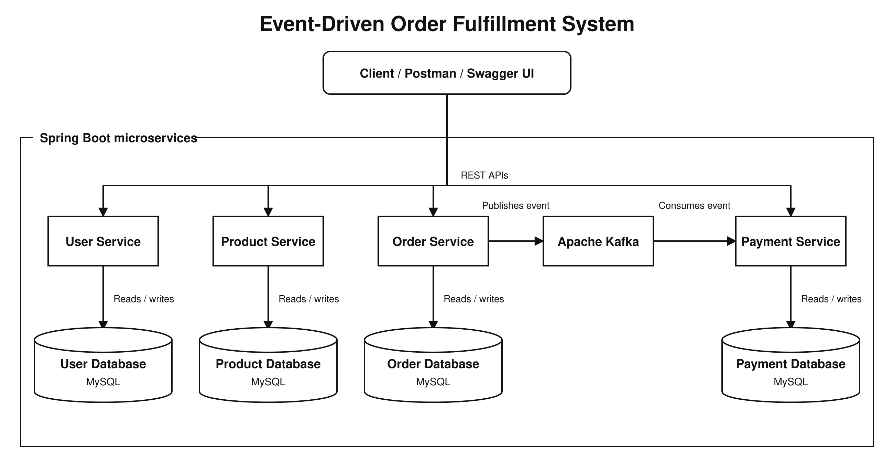

# Event-Driven Order Fulfillment System

This is a personal backend project developed to practise building microservices with Spring Boot and Apache Kafka. It models a basic order fulfilment process using separate services for orders, products, payments and users.

When a new order is created, the Order Service stores the order and publishes an event to Kafka. The Payment Service consumes the event and creates the corresponding payment record. Duplicate payment processing is prevented by checking the order number before saving a new payment.

## System Architecture


## Services

- **Order Service** – Creates and retrieves customer orders.
- **Product Service** – Manages product information and stock data.
- **Payment Service** – Processes order events received through Kafka and provides payment details.
- **User Service** – Manages user information.

## Technologies

- Java 17
- Spring Boot
- Spring Data JPA
- REST APIs
- Apache Kafka
- MySQL
- Maven
- JUnit 5 and Mockito
- Swagger/OpenAPI
- Postman
- GitHub Actions
- Docker

## Application Flow

1. The client sends a request to create an order.
2. The Order Service saves the order in its database.
3. An `OrderCreatedEvent` is published to Kafka.
4. The Payment Service consumes the event.
5. The Payment Service checks whether a payment already exists for the order.
6. If no payment exists, a new payment record is created.

## Service Ports

| Service | Port |
|---|---:|
| Order Service | 8081 |
| Product Service | 8082 |
| Payment Service | 8083 |
| User Service | 8084 |
| Kafka | 9092 |
| MySQL | 3307 → 3306 |


## Main API Endpoints

### Order Service

```text
POST /api/orders
GET  /api/orders
GET  /api/orders/{orderNumber}
```

### Payment Service

```text
GET /api/payments
GET /api/payments/order/{orderNumber}
```

The remaining endpoints can be viewed and tested through Swagger UI.

## Running the Project

### Requirements

Before starting the services, make sure the following are installed and running:

- Java 17
- Maven
- MySQL
- Apache Kafka

Update the database username and password in the `application.properties` file of each service.

Start every service separately:

```bash
cd order-service
mvn spring-boot:run
```

Repeat the command for `product-service`, `payment-service` and `user-service`.

## API Documentation

Swagger UI is available at:

```text
http://localhost:8081/swagger-ui/index.html
http://localhost:8082/swagger-ui/index.html
http://localhost:8083/swagger-ui/index.html
http://localhost:8084/swagger-ui/index.html
```

The APIs can also be tested using Postman.

## Testing

The services contain unit tests written with JUnit 5 and Mockito.

Run the tests inside an individual service:

```bash
mvn clean test
```

A GitHub Actions workflow is also configured to run the Maven tests automatically when code changes are pushed to the repository.

### Requirements

For running the complete application with Docker, make sure Docker Desktop is installed and running.

### Run with Docker Compose

The project includes a `compose.yaml` file for running the four microservices together with MySQL and Apache Kafka.

Build the Docker images:

```bash
docker compose build
```

Start all containers:

```bash
docker compose up -d
```

Check the running containers:

```bash
docker compose ps
```

View container logs:

```bash
docker compose logs
```

Stop the containers:

```bash
docker compose down
```

The `mysql-init.sql` script initializes the required MySQL databases when the MySQL container starts.

### Run Services Manually

The services can also be started individually without Docker.

Make sure Java 17, Maven, MySQL and Apache Kafka are installed and running.

Start a service using:

```bash
cd order-service
mvn spring-boot:run
```

Repeat the command for `product-service`, `payment-service` and `user-service`.

### Run with Kubernetes

The application has also been deployed locally using Kubernetes with Kind and Docker Desktop.

The setup includes separate Deployments and Services for Order, Product, Payment and User services, along with MySQL and Apache Kafka.

MySQL uses a PersistentVolumeClaim for data storage and a ConfigMap for database initialization. The Kubernetes resources run in the order-fulfillment namespace.

The Docker images for the Spring Boot services are loaded into the Kind cluster before deployment. The existing Kubernetes YAML files are available in the Kubernetes directory.

### Kubernetes Testing

The main order-to-payment flow was tested using Swagger UI.

- Created an order through the Order Service API (HTTP 201).
- Retrieved the created order using its order number (HTTP 200).
- Verified that the Payment Service consumed the order event from Kafka.
- Retrieved the corresponding payment record through the Payment Service API (HTTP 200).
- Kubernetes port-forwarding was used to access the services locally.

### API Documentation

Swagger UI is available at the following addresses when the services are accessible on their configured local ports:

- Order Service: http://localhost:8081/swagger-ui/index.html
- Product Service: http://localhost:8082/swagger-ui/index.html
- Payment Service: http://localhost:8083/swagger-ui/index.html
- User Service: http://localhost:8084/swagger-ui/index.html

The APIs can also be tested using Postman.

### Testing

The services include unit tests written using JUnit 5 and Mockito.

To run the tests for an individual service:

mvn clean test

A GitHub Actions workflow is configured to run the Maven tests when changes are pushed to the repository.

### Project Status

The four microservices, REST APIs, database operations, Kafka communication, unit tests and Docker Compose setup have been implemented.

The application has also been deployed locally using Kubernetes with Kind. The main asynchronous order-to-payment flow was tested successfully.

The project is intended for learning and practical experience with Java backend development, event-driven communication and containerized applications.

### Planned Improvements

- Additional testing for duplicate-event handling
- Spring Security and JWT authentication
- Centralised exception handling
- Improved configuration and credential management


